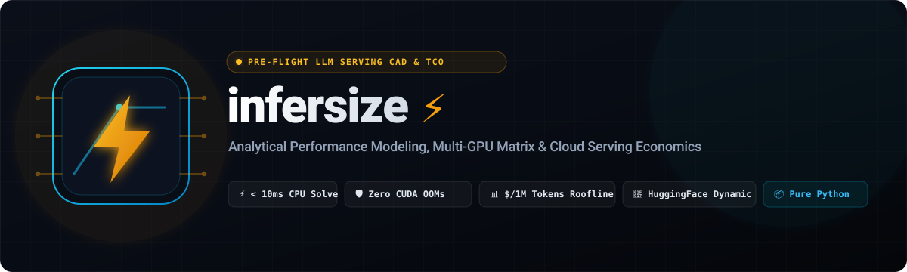

<p align="center">
  
</p>

# infersize ⚡

> **Analytical Performance Modeling, Cloud Cost (\$/1M tokens) & VRAM Capacity Planner for LLM Serving.**  
> Predict exact memory footprints, decode throughput, KV-cache scaling, multi-GPU comparison matrices, and cloud serving costs before downloading a model or spending thousands on GPU clusters.

[](https://github.com/Prajwal7-2002/infersize/actions)
[](https://pypi.org/project/infersize/)
[](https://infersize.streamlit.app/)
[](https://prajwal7-2002.github.io/infersize/)
[](https://www.python.org/downloads/)
[](https://opensource.org/licenses/Apache-2.0)
[](https://github.com/Prajwal7-2002/infersize)

---

## 🎯 Why `infersize`?

Every engineer deploying local or cloud LLMs asks the same questions:
* *"Can I run Qwen-2.5-7B on my 6GB RTX 3050 laptop?"*
* *"Which GPU should I rent on RunPod, Lambda, or AWS for the lowest cost without running out of memory?"*
* *"What is my actual operational cost per 1 Million generated tokens (\$/1M tokens) at batch size 16?"*
* *"How many concurrent users can an 80GB A100 serve at 4,000 context length before crashing with Out-Of-Memory (OOM)?"*

Renting GPU clusters just to discover a model runs out of memory or costs 10x more than closed APIs burns engineering time and cloud budgets.  
**`infersize` solves this with rigorous analytical physics**: it computes exact parameter bytes, KV-cache tensor dimensions, memory-bandwidth bound decode throughput, and cloud unit economics in **< 10 milliseconds on any CPU**.

---

## 🚀 Key Features

* **Rigorous Mathematical Accounting**: Derives exact parameter counts and tensor bytes directly from architectural specs (layers, hidden dims, GQA heads, SwiGLU FFNs).
* **Multi-GPU Comparison Matrix (`infersize compare`)**: Evaluates a model workload across candidate accelerators side-by-side, flags OOM deficits, and identifies the **Right-Sized / Cost-Effective GPU** vs **Peak Throughput GPU**.
* **Cloud Cost & TCO Engine (`infersize cost`)**:
  * Models memory-bandwidth decode throughput ($\text{tok/s} = \frac{B \cdot \text{BW} \cdot \eta}{W + KV}$).
  * Computes Time Per Output Token (TPOT latency in ms).
  * Direct cloud unit economics: **\$ / 1 Million Tokens** and monthly 24/7 dedicated hosting cost.
  * Built-in pricing for **RunPod**, **Lambda Labs**, **AWS EC2**, and **Google Cloud (GCP)**.
  * Cross-cloud comparison matrix (`--compare-clouds`) and hardware comparison (`--compare-all`).
* **Tensor Parallelism (TP) Modeling**: Partitions weights, KV cache, activations, and cluster rental rates across $N$ GPUs analytically.
* **Multi-Precision Support**: Models memory footprint across `FP32`, `FP16`/`BF16`, `INT8`/`FP8`, `INT4`/`FP4`, and `BitNet 1.58b`.
* **Sub-Byte KV-Cache Scaling**: Accurately models KV-cache savings for `FP16`, `INT8`, and `INT4` KV quantization.
* **Capacity Solvers**:
  * `max-batch`: Solves for the maximum concurrent users a GPU can host before VRAM exhaustion.
  * `max-context`: Solves for the maximum supported sequence length before OOM.
* **Dynamic Hugging Face & Custom Config Ingestion**:
  * Fetch and parse any open-weights model directly from Hugging Face Hub (e.g. `--model meta-llama/Llama-3.1-8B-Instruct`).
  * Pure standard-library HTTP resolver — **zero heavy dependencies** (no PyTorch, Transformers, or Hugging Face Hub SDK required).
  * Load local architecture files directly with `--config ./path/to/config.json`.
* **Mixture-of-Experts (MoE) Physics**:
  * Differentiates **Total Parameters** (static VRAM demand holding all $E$ experts) from **Active Parameters** (DRAM memory bus transfers for top-$K$ routed experts per decode step).
* **Architecture RFC & Sizing Report Generator (`infersize report`)**: Generates and exports publication-ready Markdown or JSON capacity specifications with executive summaries, physical memory breakdowns, multi-GPU comparison matrices, and cloud TCO economics.
* **Machine-Readable Automation (`--json`)**: Emits structured JSON schemas for CI/CD gates and infrastructure automation.
* **Hardware Profiles Built-in**: NVIDIA RTX 3050, 4060, 4090, Tesla T4, L4, A100 (40GB/80GB), H100 (80GB), H200 (141GB), and Apple Silicon M3 Max (36GB/128GB).
* **Zero GPU Dependencies**: Pure Python, runs instantaneously on Windows, macOS, and Linux.

---

## 📦 Quickstart

```bash
# Standard CLI installation (Zero external C++/CUDA dependencies)
pip install infersize

# Or with uv package manager
uv add infersize

# Optional: With interactive Streamlit Web Studio
pip install "infersize[ui]"
```

> 🌐 **Live Web Studio**: Run the interactive calculator in your browser at **[infersize.streamlit.app](https://infersize.streamlit.app/)** or launch locally via `infersize ui`.


### 1. Cloud Cost & Throughput Sizing (\$/1M Tokens)

Predict generation throughput, TPOT latency, and cost per million tokens:

```bash
infersize cost --model qwen2.5-7b --gpu rtx4090 --batch-size 16 --context 2048
```

Output:
```text
╭──────────── ⚡ INFERSIZE: CLOUD SERVING ROOFLINE & TCO ANALYSIS ─────────────╮
│ Model: qwen2.5-7b | GPU: NVIDIA GeForce RTX 4090 (24GB) (TP=1)               │
│ Provider: RUNPOD ($0.44/hr cluster) | Batch: 16 | Context: 2,048 tokens      │
│ Status: ✔ FIT - CAPACITY NORMAL                                              │
╰──────────────────────────────────────────────────────────────────────────────╯
  Metric                                      Value   Engineering Insight
 ───────────────────────────────────────────────────────────────────────────────
  Memory Bandwidth            1008 GB/s (Eff: 806.4   Assumes 80% memory bus
                                              GB/s)   saturation
  DRAM Read / Step                         17.11 GB   Weights: 15.23 GB, KV-Cache: 1.88 GB
  Time Per Output Token                     21.2 ms   47.1 tok/s per user stream
  (TPOT)
  Aggregate Throughput                  754.1 tok/s   Total generation across B=16 streams
  Hourly Token Capacity         2,714,704 tokens/hr   Maximum tokens generated per running hour
 ───────────────────────────────────────────────────────────────────────────────
  Cluster Rental Rate                    $0.44 / hr   $0.44/hr per GPU x 1 GPUs
  COST PER 1M TOKENS                        $0.1621   Direct operational unit cost
  24/7 Dedicated Monthly               $321.20 / mo   Baseline idle cluster rental (730h)
```

Compare costs across cloud providers for a single GPU:
```bash
infersize cost --model qwen2.5-7b --gpu a100-80gb --compare-clouds
```

Output:
```text
       Cloud Provider Price Comparison for NVIDIA A100 SXM4 (80GB HBM2e)
╭──────────┬──────────────┬─────────────────┬─────────────────┬────────────────╮
│ Provider │ Hourly / GPU │ Total Cluster/Hr│ Cost / 1M Tokens│ Monthly (730h) │
├──────────┼──────────────┼─────────────────┼─────────────────┼────────────────┤
│ RUNPOD   │        $1.89 │           $1.89 │         $4.9399 │       $1379.70 │
│ LAMBDA   │        $1.49 │           $1.49 │         $3.8944 │       $1087.70 │
│ AWS      │        $5.12 │           $5.12 │        $13.3821 │       $3737.60 │
│ GCP      │        $3.67 │           $3.67 │         $9.5922 │       $2679.10 │
╰──────────┴──────────────┴─────────────────┴─────────────────┴────────────────╯
```

---

### 2. Multi-GPU Comparison Matrix

Find the optimal accelerator for a workload and eliminate over-provisioning:

```bash
infersize compare --model qwen2.5-7b --quant fp16 --batch-size 1 --context 2048
```

Output:
```text
╭───────────── ⚡ INFERSIZE: MULTI-GPU HARDWARE COMPARISON MATRIX ─────────────╮
│ Model: qwen2.5-7b | Weights: FP16 | KV-Cache: FP16 | Batch: 1 | Context:     │
│ 2,048 tokens | TP: 1                                                         │
╰──────────────────────────────────────────────────────────────────────────────╯
╭──────────┬──────────┬──────────┬──────────┬──────────┬───────────┬───────────┬───────────┬──────────────────────────────╮
│ GPU      │     VRAM │ Required │ Util (%) │ Headroom │ Max Batch │ Bandwidth │ Status    │ Sizing Verdict               │
├──────────┼──────────┼──────────┼──────────┼──────────┼───────────┼───────────┼───────────┼──────────────────────────────┤
│ rtx3050  │   6.0 GB │  16.1 GB │   100.0% │ -10.1 GB │    0 reqs │  288 GB/s │ ✘ OOM     │ Deficit of 10.1 GB.          │
│ rtx4060  │   8.0 GB │  16.2 GB │   100.0% │  -8.2 GB │    0 reqs │  272 GB/s │ ✘ OOM     │ Deficit of 8.2 GB.           │
│ rtx4090  │  24.0 GB │  16.4 GB │    68.2% │  +7.6 GB │   62 reqs │ 1008 GB/s │ ⭐ OPTIMAL│ Right-sized: Optimal cost.   │
│ t4       │  16.0 GB │  16.2 GB │   100.0% │  -0.2 GB │    0 reqs │  320 GB/s │ ✘ OOM     │ Deficit of 0.2 GB.           │
│ l4       │  24.0 GB │  16.3 GB │    67.8% │  +7.7 GB │   63 reqs │  300 GB/s │ ✔ FITS    │ Healthy capacity headroom.   │
│ a100-40gb│  40.0 GB │  16.6 GB │    41.4% │ +23.4 GB │  197 reqs │ 1555 GB/s │ ✔ FITS    │ Healthy capacity headroom.   │
│ a100-80gb│  80.0 GB │  16.7 GB │    20.8% │ +63.3 GB │  537 reqs │ 2039 GB/s │ ℹ OVERKILL│ Excess VRAM headroom.        │
│ h100-80gb│  80.0 GB │  16.9 GB │    21.1% │ +63.1 GB │  535 reqs │ 3350 GB/s │ ℹ OVERKILL│ Excess VRAM headroom.        │
╰──────────┴──────────┴──────────┴──────────┴──────────┴───────────┴───────────┴───────────┴──────────────────────────────╯
╭─────────────────── 🎯 PROCUREMENT & SIZING RECOMMENDATION ───────────────────╮
│ ⭐ Recommended (Right-Sized / Cost-Effective): rtx4090 - Safest fit with     │
│ minimal idle VRAM waste and lowest hardware rental cost.                     │
│ 🚀 Recommended (Peak Throughput): h100-80gb - Highest memory bandwidth       │
╰──────────────────────────────────────────────────────────────────────────────╯
```

---

### 3. Speculative Decoding Sizer (`infersize spec`)

Analytically models joint VRAM demand and memory-bandwidth acceleration under Leviathan speculative verification:

```bash
# Sizing Qwen2.5-32B target paired with Qwen2.5-0.5B draft on an A100-80GB
infersize spec --target qwen2.5-32b --draft qwen2.5-0.5b --gpu a100-80gb --target-quant int4 --lookahead 4 --acceptance 0.75
```

---

### 4. Live Silicon Hardware Zero-OOM Verifier (`infersize fit`)

Auto-detects physical GPU/CPU accelerators and verifies whether a model workload fits without crashing:

```bash
# Auto-detect local GPU and check zero-OOM headroom
infersize fit --model qwen2.5-7b --quant int4 --context 4096
```

---

### 5. Interactive Web Sizer Studio (`infersize ui`)

Launch the visual browser dashboard with live sliders, multi-GPU comparison matrices, and RFC export:

```bash
# Install optional UI dependencies and launch local web studio
pip install "infersize[ui]"
infersize ui
```

---

### 6. Predict Detailed VRAM Footprint & Headroom

```bash
infersize vram --model qwen2.5-7b --gpu rtx3050 --quant int4 --context 4096
```

---

### 7. Solve for Maximum Concurrent Serving Batch Size

```bash
infersize max-batch --model qwen2.5-7b --gpu rtx3050 --quant int4 --context 2048
```

---

### 8. Solve for Maximum Context Window

```bash
infersize max-context --model qwen2.5-7b --gpu rtx3050 --quant int4 --batch-size 1
```

---

### 9. Export Architecture RFC & Capacity Sizing Report

Generate an engineering RFC report for deployment documentation, GitHub PRs, or infrastructure tickets:

```bash
infersize report --model qwen2.5-7b --gpu rtx4090 --batch-size 16 --context 2048 --output deployment_rfc.md
```

Output:
```text
╭──────────────── ⚡ INFERSIZE: SPECIFICATION EXPORT COMPLETE ─────────────────╮
│ ✔ Architecture RFC Report exported successfully!                             │
│                                                                              │
│ 📁 Destination: deployment_rfc.md                                            │
│ 📊 Model: qwen2.5-7b | GPU: NVIDIA GeForce RTX 4090 (24GB) (TP=1)            │
│ 💰 Unit Economics: $0.1621 / 1M tokens                                       │
│                                                                              │
│ Ready to drop directly into GitHub PRs, Engineering RFCs, or infrastructure  │
│ tickets.                                                                     │
╰──────────────────────────────────────────────────────────────────────────────╯
```

### 10. Speculative Decoding Sizer (Leviathan Physics)

Model joint VRAM footprint, memory bandwidth latency, and Leviathan speedup for draft + target models:

```bash
infersize spec --target llama3-70b --draft llama3-8b --gpu a100-80gb --acceptance 0.75 --lookahead 4
```

---

### 11. Live Local Hardware Zero-OOM Verification

Query physical NVML accelerator or host memory to analytically verify zero-OOM safety before launching workloads:

```bash
infersize fit --model qwen2.5-7b --quant int4 --batch-size 4 --context 4096
```

---

### 12. Interactive Streamlit Web Studio

Launch the full-featured browser studio locally:

```bash
infersize ui --port 8501
```

Or open the hosted cloud instance at **[infersize.streamlit.app](https://infersize.streamlit.app/)**.

---

### 13. Inspect Built-in Hardware & Models

```bash
infersize models
infersize gpus
```

---

## 📐 The Mathematical Mechanics

### 1. KV-Cache Memory Equation
$$\text{KV Bytes per Token} = 2 \times L \times H_{\text{kv}} \times D \times B$$
* $L$: Number of transformer layers
* $H_{\text{kv}}$: Number of Key-Value attention heads (Grouped-Query Attention)
* $D$: Head dimension ($\frac{d_{\text{model}}}{H_{\text{q}}}$)
* $B$: Bytes per element ($2$ for FP16, $1$ for INT8, $0.5$ for INT4)

### 2. Maximum Concurrent Batch Size Solver
$$B_{\max} = \left\lfloor \frac{\text{VRAM}_{\text{usable}} - \text{Memory}_{\text{weights}} - \text{Memory}_{\text{act}}}{\text{KV Bytes per Token} \times S} \right\rfloor$$

### 3. Memory-Bandwidth Bound Decode Throughput
$$\text{Aggregate Throughput (tokens/sec)} = \frac{B \times \text{Memory Bandwidth (GB/s)} \times 10^9 \times \eta}{W_{\text{bytes}} + \text{KV}_{\text{bytes}}}$$

### 4. Unit Cost per 1 Million Tokens (\$/1M tokens)
$$\text{Cost per 1M Tokens} = \frac{\text{Hourly Rental Rate}}{\text{Tokens per Hour}} \times 1,000,000$$

---

## 🧪 Testing

```bash
uv run pytest -v
```

---

## 📄 License

Apache 2.0. Authored by **Prajwal Pujari** (`prajwalpujari16@gmail.com`).
